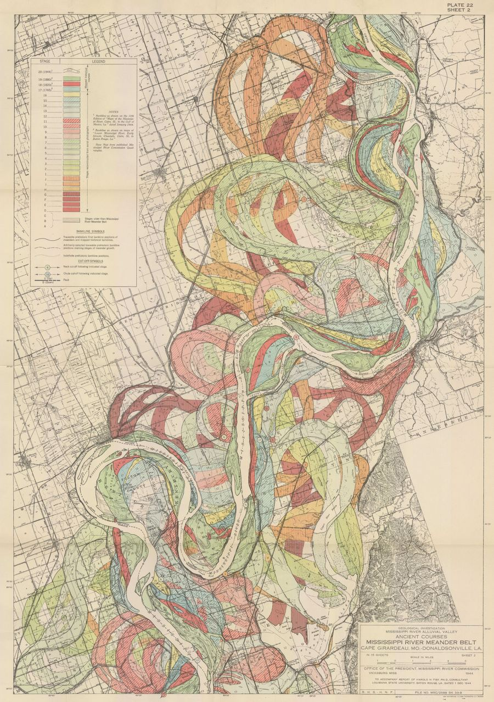

# html-maplibre-template

A starter website for telling stories with maps: maps placed between text and
images, a full-page map, and a scrollytelling story map. Copy it, change the
words and the maps, push, and GitHub publishes it for you.

It is plain HTML and CSS, with
[maplibre-yaml](https://docs.maplibre-yaml.org/), which turns a YAML file into
a [MapLibre](https://maplibre.org/) map. **There is nothing to install and no
build step**: the pages are `.html` files, every map is a YAML file you edit,
and the files in this folder are exactly what gets published. You don't need
to write JavaScript.

> **Want Markdown pages and a build step?** The
> [astro-maplibre-template](https://github.com/design-practices/astro-maplibre-template)
> has the same example maps and story, built with Astro: pages written in
> Markdown/MDX, images resized for you, and every map checked while the site
> builds. It needs Node.js and `npm install`. The YAML files work in both.

## Quick start

You need a web browser, [Git](https://git-scm.com/), and a way to start a
small local web server (step 3).

1. On GitHub, click **Use this template → Create a new repository**. The
   repository name becomes part of your site's address.
2. Clone your new repository and open the folder in a terminal:

   ```bash
   git clone https://github.com/<your-user>/<your-repo>.git
   cd <your-repo>
   ```

3. Start a local web server in the folder. Pick **one**:

   - **VS Code**: open the folder, install the recommended **Live Server**
     extension (VS Code offers it when you open the folder), then click
     **Go Live** in the bottom bar. The page reloads each time you save.
   - **Node.js** installed? Run `npx serve .` (it asks once to download
     `serve`; nothing is added to your project).
   - **Python** installed (macOS and Linux usually have it)? Run
     `python3 -m http.server` (on Windows: `py -m http.server`).

4. Open the address it prints: `http://127.0.0.1:5500/` for Live Server,
   `http://localhost:3000/` for `serve`, `http://localhost:8000/` for Python.
   Edit a file, save, and reload the page (Live Server reloads it for you).

**Why a server?** Double-clicking `index.html` opens it as a `file://`
address, and browsers don't let a page opened that way load the map files.
The home page still opens, but every map is replaced by a pink box saying
*"Open this page through a local web server"*. Start a server (step 3) and
open its `http://` address instead.

## Make it yours

### 1. Name and text

The site's name, **Project Website**, is in the header of each page. Change it
in all four `.html` files, along with each page's `<title>` and
`<meta name="description">` near the top. The text of each page is ordinary
HTML: edit it in any text editor.

Your site will be at `https://<your-user>.github.io/<your-repo>/`. You don't
need to write that address anywhere: every link and file path in this
template is *relative* (no leading `/`), so the same files work on your
computer and on GitHub Pages. Keep it that way (see
[Paths](#paths-no-leading-slash) below).

### 2. Where things live

```text
index.html            the home page
inline-maps.html      maps between text, images and embeds
full-page-map.html    one map that fills the window
scrollytelling.html   a story map
maps/                 one YAML file per map (used by the pages above)
stories/              one YAML file per story map
data/                 data files for your maps (GeoJSON, …)
img/                  images for your pages and story chapters
css/site.css          colours, fonts, the header, text and map styles
fonts/                the Inter and Lora fonts (and their licences)
.github/workflows/    checks the YAML and publishes the site (see below)
```

To add a page, copy one of the `.html` files next to the others (for example
`about.html`), change its text, and add a link to it in the header of every
page: `<a href="about.html">About</a>`.

### Paths: no leading slash

Write every path to a file of your own **without a leading `/`**:
`maps/squirrels.yaml`, `data/parks.geojson`, `img/photo.jpg`,
`css/site.css`. A path that starts with `/` points at the top of
`github.io`, not at your site, and breaks once the site is published.

Paths **inside a YAML file** start at the **page** that shows the map, not at
the YAML file. `maps/squirrels.yaml` loads its data with
`url: "data/squirrel20241021.geojson"` (not `../data/…`), because the page,
`inline-maps.html`, sits next to the `data/` folder.

Keep your pages in the top folder, next to `index.html`, so those paths keep
working. (A page in a subfolder would need `../` in front of every path, and
its maps a `base` setting:
[Publishing & subpaths](https://docs.maplibre-yaml.org/guides/publishing/#html-pages-the-base-attribute).)

## Every page has the same `<head>`

Each map page loads three things from a CDN in its `<head>`: MapLibre's
stylesheet, an *import map* that tells the browser where MapLibre is, and the
script that defines the `<ml-map>` and `<ml-scrollytelling>` elements. Copy
this block into any new page that shows a map:

```html
<link rel="stylesheet" href="https://unpkg.com/maplibre-gl@6/dist/maplibre-gl.css">
<link rel="stylesheet" href="css/site.css">
<script type="importmap">
  { "imports": { "maplibre-gl": "https://unpkg.com/maplibre-gl@6/dist/maplibre-gl.mjs" } }
</script>
<script type="module" src="https://unpkg.com/@maplibre-yaml/core@0.10/register.js"></script>
```

`@0.10` loads the newest 0.10.x release of maplibre-yaml, so bug fixes
arrive by themselves; a bigger version never arrives by surprise. Change the
number on purpose when you upgrade
([Upgrading](https://docs.maplibre-yaml.org/getting-started/upgrading/)).

## Maps

Each map is a YAML file in `maps/`. A page shows it with an `<ml-map>`
element whose `src` names the file:

```html
<ml-map src="maps/squirrels.yaml" class="map-frame" style="height: 60vh;"></ml-map>
```

Every map needs a height (`style="height: …"`): without one it is invisible.
`class="map-frame"` gives it a border and space around it (in `css/site.css`).

A map file has the map's starting view (`config:`) and its `layers:`:

```yaml
# yaml-language-server: $schema=https://docs.maplibre-yaml.org/schema/latest/map.schema.json
type: map
id: squirrels
config:
  mapStyle: "https://tiles.openfreemap.org/styles/positron" # the basemap
  center: [-73.9654, 40.7829] # [longitude, latitude]
  zoom: 13.5
layers:
  - id: squirrels
    type: circle # circle, line, fill, symbol, raster, …
    source:
      type: geojson
      url: "data/squirrel20241021.geojson" # starts at the page: no leading /
    paint:
      circle-radius: 4
      circle-color: "#c0642f"
```

The first line is a comment that gives editors autocomplete and error
underlines (in VS Code, install the recommended **YAML** extension). To find
`center` and `zoom` for a place, move around
[this location helper](https://labs.mapbox.com/location-helper/) and copy the
numbers. Note the order: **longitude first**, then latitude.

The basemaps are from [OpenFreeMap](https://openfreemap.org/) and need no API
key: `positron`, `liberty`, `bright`, `dark` and `fiord` all work in the URL
above. Any other MapLibre style URL works too.

If a map has a mistake, the map shows a box naming the problem and the line
it is on, instead of the map. Fix the YAML, save, and reload.

### What the example maps show

| You want | Look at | Key parts |
| :--- | :--- | :--- |
| A popup when a point is clicked | `maps/squirrels.yaml` | `interactive: { click: { popup: … } }` |
| Colours by category, with a legend | `maps/squirrels.yaml`, `bike-lanes.yaml` | `classify: { field, categories }` |
| Data from a file in `data/` | `maps/bike-lanes.yaml` | `source: { type: geojson, url: "data/….geojson" }` |
| Data written in the YAML | `maps/layers.yaml` (the park outline) | `source: { type: geojson, data: … }` |
| Checkboxes to turn layers on and off | `maps/layers.yaml`, `full-page.yaml` | `label:` on a layer; `visible: false` to start it off |
| A legend entry for a plain layer | `maps/layers.yaml` | `legend: { label, color, shape }` |
| A map that doesn't move | `maps/static.yaml` | `config: { interactive: false }` |
| Zoom buttons | `maps/full-page.yaml` | `controls: { navigation: true }` |
| Vector tiles (building shapes) | `maps/full-page.yaml` | `source: { type: vector, url: … }`, `source-layer: building` |

A popup is a list of HTML elements; `str:` is fixed text and `property:` is a
value from the clicked feature:

```yaml
interactive:
  hover:
    cursor: pointer
  click:
    popup:
      - h3:
          - property: name
      - p:
          - str: "Fur: "
          - property: primary_fur_color
            else: "not recorded"
```

### Full-page map

`full-page-map.html` shows `maps/full-page.yaml` with
`class="full-page-map"`, which makes the map fill the window under the header.
Any map file works there. The note in its top-left corner is ordinary HTML
inside the `<ml-map>` with `slot="top-left"`; the corners are `top-left`,
`top-right`, `bottom-left` and `bottom-right`.

### Scrollytelling

`scrollytelling.html` shows `stories/nyc.yaml` with
`<ml-scrollytelling src="stories/nyc.yaml">`. A story file is a map
(`config:`, `layers:`) plus `chapters:`. Each chapter moves the camera and can
show and hide layers:

```yaml
chapters:
  - id: squirrels
    title: Squirrels in Central Park
    description: "<p>Chapter text is <strong>HTML</strong>, not Markdown.</p>"
    image: "img/fisk02.jpg"   # optional: a file in img/
    center: [-73.96778, 40.78376]
    zoom: 14
    pitch: 0                  # tilt, 0–85
    bearing: 20               # rotation
    animation: flyTo          # flyTo (default), easeTo or jumpTo
    alignment: left           # left, right, center or full
    layers:
      show: [squirrels]       # layer ids; hide: [ … ] turns them off
```

A layer that a chapter turns on later starts hidden with
`layout: { visibility: none }`. A chapter's changes last until another chapter
undoes them.

## Adding your own data

Put the file in `data/` and point a layer at it with `data/<file name>` (no
leading `/`). GeoJSON is simplest; export it from QGIS,
[geojson.io](https://geojson.io/) or most data portals. Keep files small (a
few MB at most); for bigger data see
[Large data](https://docs.maplibre-yaml.org/guides/cloud-native-data/). (Large
formats such as PMTiles need a local server that supports *range requests*:
`npx serve` does, `python3 -m http.server` doesn't.)

A `url:` can also be a web address, such as an open-data API. That data is
fetched each time someone opens the page, so the site breaks if that service
goes down or changes. Saving a copy in `data/` avoids that: the bike lanes in
`maps/bike-lanes.yaml` are a snapshot of
[NYC Open Data](https://data.cityofnewyork.us/Transportation/New-York-City-Bike-Routes/mzxg-pwib)
saved as `data/manhattan-bike-lanes.geojson`.

If a data file doesn't load (a typo in its name, say), the map still draws
and a notice on it names the file that failed.

## Text, images and maps together (HTML)

Pages are plain HTML. `inline-maps.html` shows each of these:

- **Text**: `<h2>` headings, `<p>` paragraphs, `<ul>`/`<li>` lists,
  `<strong>`, `<a href="https://…">links</a>`. Text inside `<article>` gets
  the site's text styles.
- **Maps**: `<ml-map src="maps/….yaml" class="map-frame" style="height: 50vh;"></ml-map>`, as above.
- **Images**: put the file in `img/` and add an `` with an `alt` text
  that describes it. Resize big photos and scans before you add them (a few
  hundred KB is plenty for the web):

  ```html
  
  ```

- **Embeds**: any HTML, such as an `<iframe>` with a video.
- **Two columns**: a `<div class="two-columns">` holding a map and text side
  by side (stacked on phones):

  ```html
  <div class="two-columns">
    <ml-map src="maps/static.yaml" class="map-frame" style="height: 320px;"></ml-map>
    <div>
      <h3>Central Park</h3>
      <p>Text next to the map.</p>
    </div>
  </div>
  ```

Colours, fonts and spacing are in `css/site.css`; the colours are at the top.

## Checking your work

A mistake in a YAML file shows on the page (the map is replaced by a box
naming the problem). To check every map and story file at once, with the
file, line and column of each problem, run this in the project folder (it
needs [Node.js](https://nodejs.org/) 20.9 or later; optional):

```bash
npx @maplibre-yaml/cli@0.7 validate maps stories
```

```text
✗ stories/nyc.yaml
  error Chapter 2 ("squirrels"): Unknown key "centre" — did you mean "center"? ("center" is required here.)
    at line 72, column 5
```

GitHub runs the same check on every push and pull request (below), so you'll
also see mistakes there.

## Publishing on GitHub Pages

1. On GitHub: **Settings → Pages → Build and deployment → Source: GitHub Actions**.
2. Push to `main`. The workflow in `.github/workflows/deploy.yml` checks every
   YAML file in `maps/` and `stories/`, then publishes the folder as it is;
   follow it in the **Actions** tab. Your site is at
   `https://<your-user>.github.io/<your-repo>/` a minute or two later.

If the check fails, open the failed run in the Actions tab: the log names the
file and line. The published site stays as it was until a check passes.

(Pushed before step 1? The first run fails at the deploy step. Do step 1,
then open the failed run in the **Actions** tab and click **Re-run all jobs**.)

## Learn more

- [maplibre-yaml documentation](https://docs.maplibre-yaml.org/)
  - [HTML pages: the `<ml-map>` element](https://docs.maplibre-yaml.org/integrations/web-components/) and [every attribute](https://docs.maplibre-yaml.org/reference/elements/)
  - [Story maps in plain HTML](https://docs.maplibre-yaml.org/integrations/scrollytelling-html/) and [writing a story file](https://docs.maplibre-yaml.org/schema/scrollytelling/)
  - [Layers and styling](https://docs.maplibre-yaml.org/guides/layers/), [popups and controls](https://docs.maplibre-yaml.org/guides/popups/), [legends and thematic maps](https://docs.maplibre-yaml.org/guides/thematic-maps/), [data sources](https://docs.maplibre-yaml.org/guides/data-sources/)
  - [Every layer key](https://docs.maplibre-yaml.org/reference/yaml/layers/), [the validate command](https://docs.maplibre-yaml.org/cli/reference/#validate), [editor setup](https://docs.maplibre-yaml.org/guides/editor-setup/)
  - [Publishing and subpaths](https://docs.maplibre-yaml.org/guides/publishing/), [Troubleshooting](https://docs.maplibre-yaml.org/troubleshooting/)
  - [Example gallery](https://docs.maplibre-yaml.org/examples/gallery/): dozens of maps to copy from
- [MapLibre style properties](https://maplibre.org/maplibre-style-spec/layers/): every `paint` and `layout` key
- [MDN: Learn HTML](https://developer.mozilla.org/en-US/docs/Learn_web_development/Core/Structuring_content) and [Learn CSS](https://developer.mozilla.org/en-US/docs/Learn_web_development/Core/Styling_basics)

## Credits

Squirrel data: 2018 Central Park Squirrel Census (NYC Open Data). Bike lanes:
NYC DOT, via NYC Open Data. Basemap: [OpenFreeMap](https://openfreemap.org/),
© [OpenStreetMap](https://www.openstreetmap.org/copyright) contributors.
Fonts: [Inter](https://rsms.me/inter/) and
[Lora](https://github.com/cyrealtype/Lora-Cyrillic), SIL Open Font License
(`fonts/LICENSE-*.txt`).
